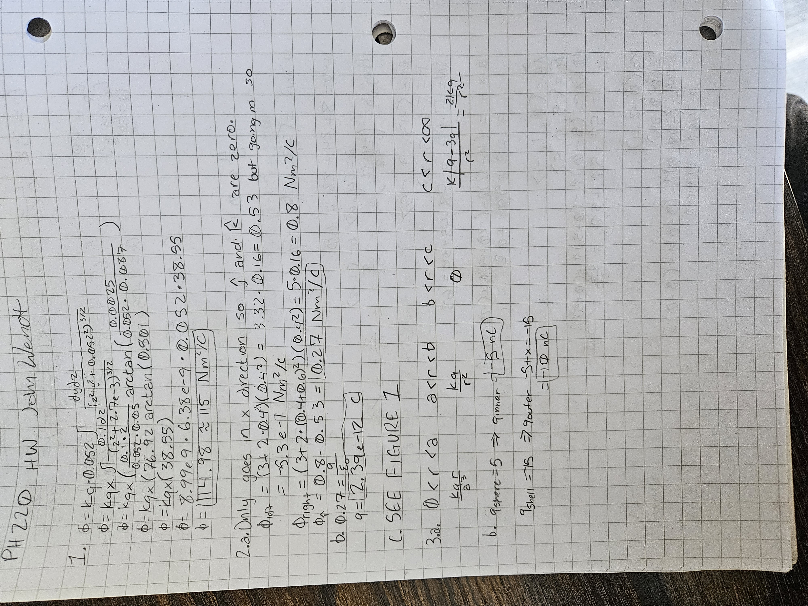

```{python}
import polars as pl
import numpy as np
import math
from lets_plot import *
import matplotlib.pyplot as plt
import matplotlib.patches as patches

LetsPlot.setup_html(isolated_frame=True)
```


{width=400px}

## Figure 1

```{python}
x = np.linspace(0.0, 1.2, 15)
y = np.linspace(-0.2, 0.6, 10)
X, Y = np.meshgrid(x, y)

X_flat = X.flatten()
Y_flat = Y.flatten()

E_x = 3.0 + 2.0 * X_flat**2
scaler = 0.03
X_end = X_flat + E_x * scaler
Y_end = Y_flat

df_vectors = pl.DataFrame({
    "x": X_flat,
    "y": Y_flat,
    "xend": X_end,
    "yend": Y_end,
    "E_mag": E_x
})
df_box = pl.DataFrame({
    "xmin": [0.4],
    "xmax": [1.0],
    "ymin": [0.0],
    "ymax": [0.4]
})

aplot = (
    ggplot()
    + geom_rect(
        data=df_box,
        mapping=aes(xmin='xmin', xmax='xmax', ymin='ymin', ymax='ymax'),
        fill='red',
        alpha=0.2,
        color='red',
        size=1
    )
    + geom_segment(
        data=df_vectors,
        mapping=aes(x='x', y='y', xend='xend', yend='yend', color='E_mag'),
        arrow=arrow(type='closed', length=6),
        size=0.8
    )
    + scale_color_gradient(low='blue', high='red', name='|E| (N/C)')
    + coord_cartesian(xlim=[-0.05, 1.25], ylim=[-0.25, 0.65])
    + labs(
        title="Electric Field Vector Plot: E = (3.0 + 2.0x^2) i_hat N/C",
        x="x (m)",
        y="y (m)"
    )
    + ggsize(750, 450)
)
aplot
```

# Figure 2

```{python}
r_r1 = np.linspace(0, 0.02, 100)
E_r1 = (8.99e9 * 5e-9 / 0.02**3) * r_r1
r_r2 = np.linspace(0.02, 0.04, 100)
E_r2 = (8.99e9 * 5e-9) / (r_r2**2)
r_r3 = np.linspace(0.04, 0.048, 50)
E_r3 = np.zeros_like(r_r3)
r_r4 = np.linspace(0.048, 0.10, 200)
E_r4 = (8.99e9 * abs(-10e-9)) / (r_r4**2)

df_E = pl.DataFrame({
    "r": np.concatenate([r_r1, r_r2, r_r3, r_r4]),  # meters (m)
    "E": np.concatenate([E_r1, E_r2, E_r3, E_r4]),  # N/C
    "region": (
        ["1: 0 < r < a"] * 100 + 
        ["2: a < r < b"] * 100 + 
        ["3: b < r < c"] * 50 + 
        ["4: r > c"] * 200
    )
})

df_boundaries = pl.DataFrame({
    "x": [0.02, 0.04, 0.048]
})

bplot = (
    ggplot()
    + geom_line(
        data=df_E,
        mapping=aes(x="r", y="E", group="region"),
        color="#1f77b4",
        size=1.2
    )
    + geom_vline(
        data=df_boundaries,
        mapping=aes(xintercept="x"),
        linetype="dashed",
        color="gray",
        size=0.7
    )
    + coord_cartesian(xlim=[0, 0.10], ylim=[0, 120000])
    + labs(
        title="Electric Field Magnitude |E(r)| vs Radius",
        x="Radius r (m)",
        y="Electric Field Magnitude |E| (N/C)"
    )
    + ggsize(750, 450)
)
bplot
```